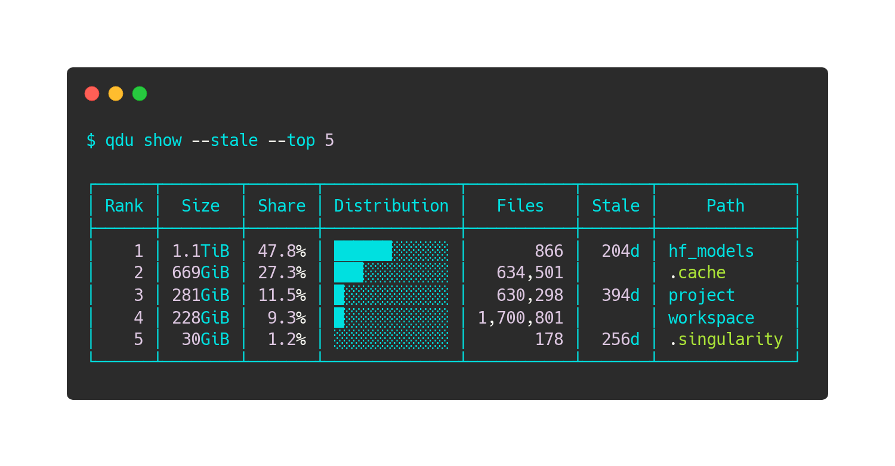

# qdu

English | [日本語](https://github.com/Onely7/qdu/blob/main/README_ja.md)



`qdu` (quick `du`) records directory usage as snapshots, so you can inspect rankings and changes without rescanning a large tree for every query. It is a single executable written in Rust that scans directories in parallel.

```bash
qdu snapshot   # record the current state
qdu show       # display the largest directories
qdu diff       # display changes since the previous snapshot
```

It does not require `sudo`. It scans what the current user can read; a directory the user may not read is recorded, listed by `qdu errors`, and left out of the totals.

## Features

- Persistent directory-usage snapshots and ranked diffs
- Parallel scanning, which pays off most on NFS and other network storage
- Allocated-size, apparent-size, file-count, and inode analysis
- The history of a directory across snapshots, with its growth per week and when it would fill the capacity limit or the disk
- Snapshots named by position, age, date, or label, such as `qdu diff --from 30d`
- Optional owner statistics and large-file candidates
- Staleness annotations and operational capacity limits
- Named profiles for multiple scan roots
- Explicit one-filesystem or cross-filesystem scanning
- Human-readable tables plus TSV and JSON output with a fixed layout for scripts
- Scan progress on terminals and the disk space used by each snapshot
- Verification, repair, retention, and automatic gzip compaction

## Requirements

- Linux or macOS on x86_64 or arm64
- Nothing else at run time: qdu is one self-contained executable

Only `qdu browse` requires the optional [`fzf`](https://github.com/junegunn/fzf) executable.

## Install

qdu is published on PyPI as a package that installs the executable. With [uv](https://docs.astral.sh/uv/), try it without installing anything:

```bash
uvx qdu --help
```

To keep it, for example for scheduled snapshots, install it as a tool. `pipx` and `pip` work the same way:

```bash
uv tool install qdu    # or: pipx install qdu, or: python3 -m pip install --user qdu
qdu --version
```

Without Python, download the executable for your platform from the [latest release](https://github.com/Onely7/qdu/releases/latest):

```bash
mkdir -p "$HOME/.local/bin"
curl -fL https://github.com/Onely7/qdu/releases/latest/download/qdu-x86_64-unknown-linux-gnu.tar.gz \
  | tar -xz -C "$HOME/.local/bin" qdu
export PATH="$HOME/.local/bin:$PATH"
qdu --version
```

| Archive | Platform |
|---|---|
| `qdu-x86_64-unknown-linux-gnu`, `qdu-aarch64-unknown-linux-gnu` | Linux with glibc 2.17 or later, which covers most distributions |
| `qdu-x86_64-unknown-linux-musl`, `qdu-aarch64-unknown-linux-musl` | Linux without glibc, such as Alpine. These are static, and musl's memory allocator is slower under many threads, so prefer the glibc build where it runs |
| `qdu-x86_64-apple-darwin`, `qdu-aarch64-apple-darwin` | macOS on Intel and on Apple silicon |

`SHA256SUMS` in the release holds the checksums of the archives. To build from source instead, see [Getting started](https://github.com/Onely7/qdu/blob/main/docs/GETTING_STARTED.md).

## First use

With no profile or path option, qdu uses the `default` profile and scans your home directory. The first snapshot of a new profile keeps the directory and the settings it was given, so later snapshots need no options:

```bash
qdu snapshot --path /data/my-project --with-users   # or just: qdu snapshot
qdu show --max-depth 2 --top 30                     # or: qdu -L 2 -n 30

# Take another snapshot later, then compare complete snapshots.
qdu snapshot
qdu diff --growth-only

# Take a snapshot every Monday at 03:15 with cron.
qdu schedule --install
```

Install qdu with `uv tool install` or another method above before `qdu schedule`: cron needs an executable that stays in place, and the copy that `uvx` runs lives in uv's cache.

Snapshots contain measurements and paths, not file contents.

## Profiles

Use profiles to keep scan roots, retention, and analysis options separate:

```bash
qdu profile set project-data --path /data/my-project
qdu snapshot --profile project-data
qdu show --profile project-data
```

Profile names may contain ASCII letters, digits, `.`, `_`, and `-`, up to 64 characters. A name that is neither configured nor has snapshots is refused with the closest known name, so a typo does not scan your home directory.

For autofs, NFS, or another layout in which child directories are separate filesystems, opt in explicitly:

```bash
qdu profile set shared-home \
  --path /home \
  --cross-filesystems \
  --with-users
```

## Common analysis

```bash
# What is inside one directory, and how it changed in the last month
qdu show data/models
qdu diff data/models --from 30d

# How a directory grew, and when the disk or the capacity limit would fill
qdu history data

# Stale areas and files
qdu show --stale-only 90d --max-depth 4 --top 100
qdu files --stale-only 90d --top 30

# Capacity policy
qdu show --capacity-limit 2TiB
qdu check --capacity-limit 2TiB

# Files and inodes
qdu files --top 30
qdu show --metric inodes --max-depth 3 --top 30

# Keep a snapshot as a reference point
qdu label before-cleanup
qdu diff --from @before-cleanup
```

## Storage

Configuration:

```text
${XDG_CONFIG_HOME:-$HOME/.config}/qdu/config.ini
```

Snapshot state:

```text
${XDG_STATE_HOME:-$HOME/.local/state}/qdu/profiles/<profile>/
```

qdu validates profile path components and indexed snapshot basenames before filesystem operations. SQLite values are bound parameters, and query metrics are selected from fixed allow lists.

## Documentation

| Document | Purpose |
|---|---|
| [Documentation index](https://github.com/Onely7/qdu/blob/main/docs/README.md) | Find the appropriate guide |
| [Getting started](https://github.com/Onely7/qdu/blob/main/docs/GETTING_STARTED.md) | Installation and first workflow |
| [Snapshots and scanning](https://github.com/Onely7/qdu/blob/main/docs/SNAPSHOTS_AND_SCANNING.md) | Permissions, exclusions, mounts, NFS, and autofs |
| [Analysis guide](https://github.com/Onely7/qdu/blob/main/docs/ANALYSIS_GUIDE.md) | Rankings, diffs, history, users, files, inodes, and staleness |
| [Configuration and storage](https://github.com/Onely7/qdu/blob/main/docs/CONFIGURATION_AND_STORAGE.md) | Profiles, XDG files, and snapshot state |
| [Operations](https://github.com/Onely7/qdu/blob/main/docs/OPERATIONS.md) | Verification, repair, labels, compaction, checks, and exit codes |
| [Troubleshooting](https://github.com/Onely7/qdu/blob/main/docs/TROUBLESHOOTING.md) | Common failures and diagnostics |
| [Command reference](https://github.com/Onely7/qdu/blob/main/docs/COMMAND_REFERENCE.md) | Commands, snapshot selectors, and output formats |
| [Development](https://github.com/Onely7/qdu/blob/main/docs/DEVELOPMENT.md) | Tests, quality checks, CI, security, and layout |
| [Weekly snapshots with tmux](https://github.com/Onely7/qdu/blob/main/docs/QDU_TMUX_WEEKLY_SNAPSHOT_GUIDE.md) | Scheduling without cron |

Run `qdu --help` or `qdu <command> --help` for the authoritative options accepted by the installed version.
